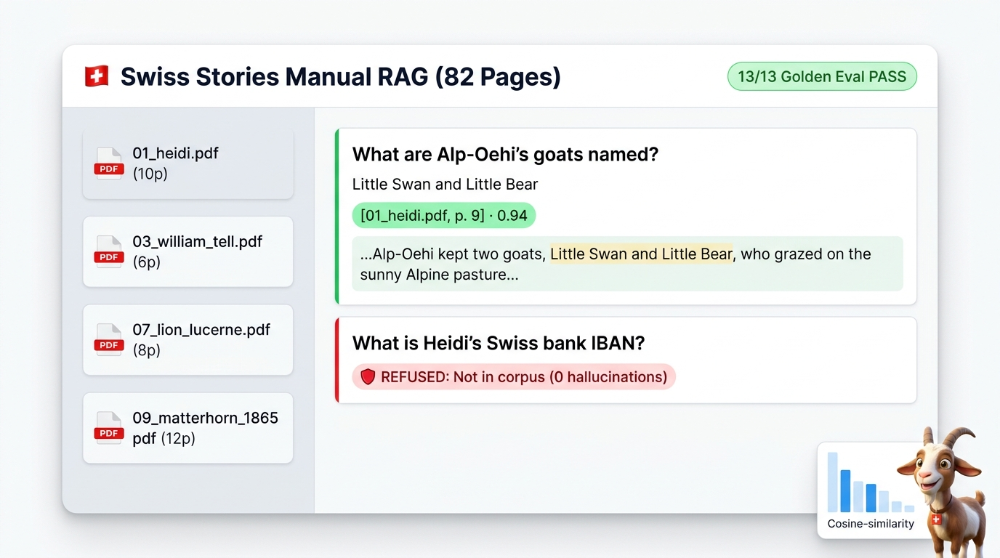
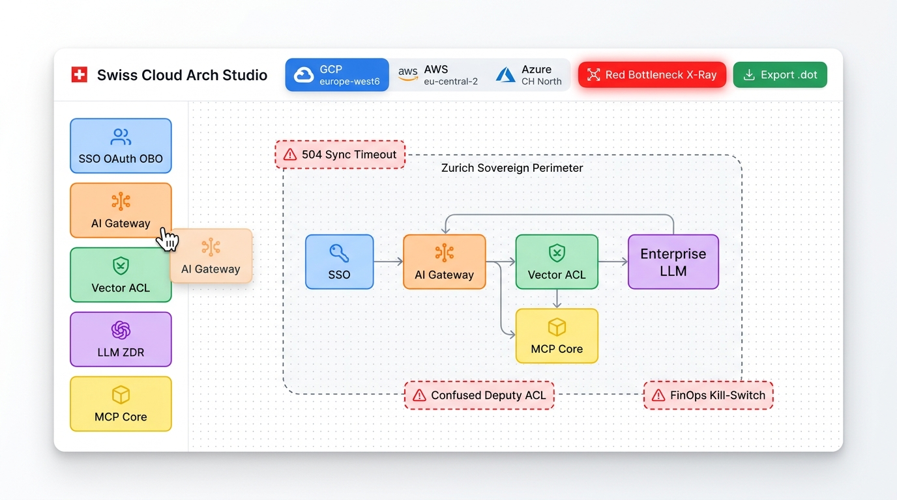
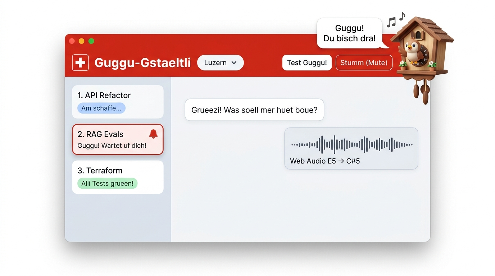

# HSLU Harness Hackathon: 3 Tracks x 2 Rounds (6 Ready-to-Copy Prompts!)

> **Same challenge. Same AI coding harness (`Antigravity CLI (agy)`, `Gemini CLI`, `Claude Code`, or `OpenAI Codex`). Pick 1 of 3 difficulty tracks, build it TWICE (`Pre-Riccardo` vs. `Post-Riccardo`), and prove your objective `0..100` + Harbor `reward = 1.0` jump!**

Built for **HSLU `CAS Cloud Architecture` — Module M3 (*AI/ML Solutions with the Cloud*, 27 Nov 2026)**.
Everything — all 3 PRDs, **10 authentic multi-page Swiss PDFs (82 pages!)**, 5 enterprise cloud scenarios, `grader.py`, and the Harbor eval task — is **bundled offline right inside this repo**.

---

## How It Works in 30 Seconds (`3 Tracks x 2 Rounds = 6 Prompts`)

```text
  STEP 1: PICK ONE TRACK (your difficulty level)
    ├── Track 0 (Starter, 45-60m)  : Swiss Stories Manual RAG (82-page 10-PDF corpus)
    ├── Track 1 (Medium,  1.5-2.5h): Swiss Cloud Arch Diagram Draw (CLI or Drag-and-Drop)
    └── Track 2 (Boss,    3-5h)    : Guggu-Gstaeltli Swiss-German Cuckoo UI Harness

  STEP 2: RUN TWO ROUNDS ON THAT SAME TRACK (in two separate folders!)
    ├── Round 1 — Pre-Riccardo  (./round1-pre-riccardo/) : Blind Exam baseline ("your normal way", NO peeking at grader.py!)
    └── Round 2 — Post-Riccardo (./round2-post-riccardo/): Fresh session + SPEC.md + 3+ Harness Tricks + /goal Harbor Eval (reward = 1.0)

  STEP 3: PROVE THE DELTA & PING @palladius
    └── python3 grader.py --compare ./round1-pre-riccardo ./round2-post-riccardo --track <rag|arch|guggu>
```

| Track (Pick ONE!) | Level | Round 1: Pre-Riccardo (Blind Exam) | Round 2: Post-Riccardo (Tricks + Evals) |
|---|---|---|---|
| **Track 0: Swiss Stories Manual RAG** | Starter | [Jump to Prompt 0.1](#prompt-01--round-1-pre-riccardo-blind-exam-baseline) | [Jump to Prompt 0.2](#prompt-02--round-2-post-riccardo-superpowers--evals) |
| **Track 1: Swiss Cloud Arch Draw** | Medium | [Jump to Prompt 1.1](#prompt-11--round-1-pre-riccardo-blind-exam-baseline) | [Jump to Prompt 1.2](#prompt-12--round-2-post-riccardo-superpowers--evals) |
| **Track 2: `Guggu-Gstaeltli` UI Harness** | Boss Mode | [Jump to Prompt 2.1](#prompt-21--round-1-pre-riccardo-blind-exam-baseline) | [Jump to Prompt 2.2](#prompt-22--round-2-post-riccardo-superpowers--evals) |

---

## Quick Start: Clone & Launch Your Harness (`AGENTS.md` Included!)

```bash
git clone https://github.com/palladius/harness-hackathon.git
cd harness-hackathon

# Launch your favorite AI coding harness (all auto-read AGENTS.md!):
agy        # Antigravity CLI (https://antigravity.google/download) -- or: agy -i "Start the hackathon!"
gemini     # Gemini CLI  (https://github.com/google-gemini/gemini-cli)
codex      # OpenAI Codex CLI
claude     # Claude Code
```

- **Single Source of Truth**: [`AGENTS.md`](AGENTS.md) drives every harness (`GEMINI.md` and `CLAUDE.md` are thin symlinks to `AGENTS.md`).
- **Two Ways to Start**:
  1. **Autopilot Mode**: Just open your harness and type **`Start the hackathon!`** — it asks **1 personalization question** and guides you automatically.
  2. **Copy-Paste Prompt Mode**: Jump straight to your chosen Track below and paste **Prompt X.1**, then start a fresh session and paste **Prompt X.2**!
- **Antigravity CLI (`agy`) Tips**: `agy -i "<prompt>"` (start interactively with prompt) | `agy -c` (resume) | `agy models` | `agy plugin list`.

---

## Track 0: Swiss Stories Manual RAG (Starter · 45-60 min)

Build a transparent, manual RAG system (chunking + TF-IDF/BM25 or embeddings + strict page citations + anti-hallucination refusal) over **10 authentic multi-page Swiss PDFs (82 pages, ~331k chars)** in [`corpus/swiss-stories/`](corpus/swiss-stories/): *Heidi*, *William Tell*, *Ruetli 1291*, *Devil's Bridge*, *Mark Twain's Lion of Lucerne*, *Mount Pilatus / Pilatusbahn 48%*, *Edward Whymper's 1865 Matterhorn*, and *Swiss Federal Constitution*.
Full stack-agnostic PRD: [`tracks/track0-swiss-rag.md`](tracks/track0-swiss-rag.md).



#### Prompt 0.1 — Round 1: Pre-Riccardo (Blind Exam Baseline)

```text
Read exercises/ex1-yolo.md and tracks/track0-swiss-rag.md.
I choose Track 0 (Swiss Stories Manual RAG over the 10 bundled PDFs in ./corpus/swiss-stories/).
Complete Round 1 (Pre-Riccardo) strictly inside ./round1-pre-riccardo/ using your normal default workflow.
BLIND EXAM RULE: Do NOT read grader.py or peek at the trap answers in corpus/swiss-stories/golden_qa.json while building!
Ask me my preferred tech stack (offline Python/TS/Go/Ruby or live Ollama/Gemini), build the RAG app, and at the very end run:
  python3 grader.py ./round1-pre-riccardo --track rag
Save the output to ./round1-pre-riccardo/SCORE_ROUND1.txt and report my baseline score!
```

> Or 1-line with Antigravity CLI: `agy -i "Read exercises/ex1-yolo.md and tracks/track0-swiss-rag.md. Complete Round 1 (Pre-Riccardo Blind Exam) for Track 0 inside ./round1-pre-riccardo/ without peeking at grader.py, then grade with --track rag."`

#### Prompt 0.2 — Round 2: Post-Riccardo (Superpowers + Evals)

Start a **brand-new session**, then paste:

```text
Read exercises/ex2-harness.md and tracks/track0-swiss-rag.md.
Rebuild Track 0 (Swiss Stories Manual RAG) cleanly from scratch inside ./round2-post-riccardo/ (do NOT copy code from Round 1; only inspect ./round1-pre-riccardo/SCORE_ROUND1.txt to fix Round 1 gaps by design).
1. First run /grill-me to lock a stack-agnostic ./round2-post-riccardo/SPEC.md before picking the tech stack.
2. Enable 3+ of Uncle Riccardo's Harness Tricks (e.g., Superpowers TDD, /learn into AGENTS.md, /swarm adversarial review).
3. Wire the 3-Tier Eval Chain: run all 13 cases of corpus/swiss-stories/golden_qa.json -> eval_results.json (including 3/3 refusal traps!), then loop with /goal until:
   ./evals/harbor-task/tests/test.sh ./round2-post-riccardo rag swiss-stories
   exits 0 and writes 1.0 to reward.txt (score >= 95/100).
4. Run `python3 grader.py --compare ./round1-pre-riccardo ./round2-post-riccardo --track rag`, write ./RETRO.md, and help me push to GitHub + open an Issue pinging @palladius!
```

---

## Track 1: Swiss Cloud Arch Diagram Draw (Medium · 1.5-2.5 h)

Build either **Option 1A (Headless CLI `.dot` Compiler)** OR **Option 1B (Interactive Drag-and-Drop Cloud Canvas)** for your favorite cloud (`GCP europe-west6`, `AWS eu-central-2`, `Azure Switzerland North`) across 5 regulated Swiss enterprise scenarios ([`scenarios/`](scenarios/)) with a **Red Bottleneck & SPOF X-Ray** and `ARCHITECTURE.md` compliance spec.
Full stack-agnostic PRD: [`tracks/track1-cloud-arch.md`](tracks/track1-cloud-arch.md).



#### Prompt 1.1 — Round 1: Pre-Riccardo (Blind Exam Baseline)

```text
Read exercises/ex1-yolo.md and tracks/track1-cloud-arch.md.
I choose Track 1 (Swiss Cloud Arch Diagram Draw) using Scenario 02 (./scenarios/02_cantonal_bank_mortgage_rag.md -- or ask me if I prefer another scenario 01..05).
Complete Round 1 (Pre-Riccardo) strictly inside ./round1-pre-riccardo/ using your normal default workflow.
BLIND EXAM RULE: Do NOT read grader.py while building!
Ask me whether I want Option 1A (CLI) or Option 1B (Drag-and-Drop Canvas) and my preferred tech stack, build it, and at the very end run:
  python3 grader.py ./round1-pre-riccardo --track arch --scenario 02
Save the output to ./round1-pre-riccardo/SCORE_ROUND1.txt and report my baseline score!
```

> Or 1-line with Antigravity CLI: `agy -i "Read exercises/ex1-yolo.md and tracks/track1-cloud-arch.md. Complete Round 1 (Pre-Riccardo Blind Exam) for Track 1 Scenario 02 inside ./round1-pre-riccardo/ without peeking at grader.py, then grade with --track arch."`

#### Prompt 1.2 — Round 2: Post-Riccardo (Superpowers + Evals)

Start a **brand-new session**, then paste:

```text
Read exercises/ex2-harness.md and tracks/track1-cloud-arch.md.
Rebuild Track 1 (Swiss Cloud Arch Diagram Draw, same scenario as Round 1) cleanly from scratch inside ./round2-post-riccardo/ (do NOT copy code from Round 1; only inspect ./round1-pre-riccardo/SCORE_ROUND1.txt).
1. First run /grill-me to lock a stack-agnostic ./round2-post-riccardo/SPEC.md before choosing the tech stack (CLI or Drag-and-Drop Canvas).
2. Enable 3+ of Uncle Riccardo's Harness Tricks (e.g., Superpowers TDD, Conductor + Worktrees + GitHub Issues, /learn into AGENTS.md, /swarm FINMA+SRE review).
3. Wire the 3-Tier Eval Chain: verify real `dot -Tsvg` compilation for GCP/AWS/Azure Swiss regions + 3+ Red X-Ray bottlenecks + revDSG/OBO/FinOps compliance, then loop with /goal until:
   ./evals/harbor-task/tests/test.sh ./round2-post-riccardo arch 02
   exits 0 and writes 1.0 to reward.txt (score >= 95/100).
4. Run `python3 grader.py --compare ./round1-pre-riccardo ./round2-post-riccardo --track arch --scenario 02`, write ./RETRO.md, and help me push to GitHub + open an Issue pinging @palladius!
```

---

## Track 2: `Guggu-Gstaeltli` Swiss UI Harness (Boss Mode · 3-5 h)

Build your own **Swiss-branded (`#D52B1E` + Swiss Cross)** multi-conversation AI coding UI Harness that speaks authentic **Schwiizerduetsch** (*"Grueezi!"*, *"Am schaffe..."*, *"Alli Tests grueen!"*) and plays a synthesized **`"Guggu! Guggu!"`** Cuckoo chime (`E5 -> C#5` Web Audio + animated cuckoo bird + `"Stumm"` Mute button) whenever **ANY** parallel conversation thread waits for your human turn!
Full stack-agnostic PRD: [`tracks/track2-guggu-harness.md`](tracks/track2-guggu-harness.md).



#### Prompt 2.1 — Round 1: Pre-Riccardo (Blind Exam Baseline)

```text
Read exercises/ex1-yolo.md and tracks/track2-guggu-harness.md.
I choose Track 2 Boss Mode (Guggu-Gstaeltli -- Swiss-German multi-thread UI Harness with synthesized Cuckoo chime).
Complete Round 1 (Pre-Riccardo) strictly inside ./round1-pre-riccardo/ using your normal default workflow.
BLIND EXAM RULE: Do NOT read grader.py while building!
Ask me my preferred Swiss canton/dialect and tech stack (Electron, Tauri, Flutter Desktop, PyWebView, or zero-install Localhost HTML5), build it with an offline Mock mode, and at the very end run:
  python3 grader.py ./round1-pre-riccardo --track guggu
Save the output to ./round1-pre-riccardo/SCORE_ROUND1.txt and report my baseline score!
```

> Or 1-line with Antigravity CLI: `agy -i "Read exercises/ex1-yolo.md and tracks/track2-guggu-harness.md. Complete Round 1 (Pre-Riccardo Blind Exam) for Track 2 Boss Mode inside ./round1-pre-riccardo/ without peeking at grader.py, then grade with --track guggu."`

#### Prompt 2.2 — Round 2: Post-Riccardo (Superpowers + Evals)

Start a **brand-new session**, then paste:

```text
Read exercises/ex2-harness.md and tracks/track2-guggu-harness.md.
Rebuild Track 2 Boss Mode (Guggu-Gstaeltli Swiss-German Cuckoo UI Harness) cleanly from scratch inside ./round2-post-riccardo/ (do NOT copy code from Round 1; only inspect ./round1-pre-riccardo/SCORE_ROUND1.txt).
1. First run /grill-me to lock a stack-agnostic ./round2-post-riccardo/SPEC.md (state machine, dialect catalog, audio synth spec, mute toggle, offline mock + optional agy/gemini/claude/codex bridge) before choosing the UI stack.
2. Enable 3+ of Uncle Riccardo's Harness Tricks (e.g., Superpowers TDD, Conductor + Worktrees, /learn into AGENTS.md, /swarm adversarial UX/security review).
3. Wire the 3-Tier Eval Chain: automated state-machine (`working -> needs_human_turn -> cuckoo chime`) & dialect tests, then loop with /goal until:
   ./evals/harbor-task/tests/test.sh ./round2-post-riccardo guggu boss
   exits 0 and writes 1.0 to reward.txt (score >= 95/100). (Bonus Tier 3: try `google-agents-cli` eval run/analyze/compare!)
4. Run `python3 grader.py --compare ./round1-pre-riccardo ./round2-post-riccardo --track guggu`, write ./RETRO.md, and help me push to GitHub + open an Issue pinging @palladius!
```

---

## Local Commands (`justfile`) & Public Resources

- **Run grader & unit tests locally**: `just test` | `just grade round1-pre-riccardo rag` | `just compare round1-pre-riccardo round2-post-riccardo rag`
- **Bundled 10 Multi-Page Swiss PDFs + `golden_qa.json`**: [`corpus/swiss-stories/`](corpus/swiss-stories/) *(82 real pages, ~331k chars, ~287 KB total — authentic Wikisource Public Domain classics & Wikipedia CC BY-SA 4.0 chronicles)*
- **Harbor Eval Task**: [`evals/harbor-task/`](evals/harbor-task/task.toml) | <https://harborframework.com/>
- **Live Web Hub & 7-Slide Deck (Browser Preview)**: [Hackathon Hub](https://storage.googleapis.com/palladius-genai-storagify/hslu/2026-11-27-m3-v1.0.2/hackathon.html) | [7-Slide Deck](https://storage.googleapis.com/palladius-genai-storagify/hslu/2026-11-27-m3-v1.0.2/hackathon-slides.html) *(also bundled locally in [`slides/index.html`](slides/index.html))*
- **Antigravity CLI (`agy`)**: <https://antigravity.google/download> | **Google Agents CLI (`agents-cli`)**: <https://github.com/google/agents-cli>
- **Conductor + Git Worktrees + GitHub Issues + HITL**: [Part 1](https://ricc.rocks/en/posts/technology/2026-06-16-crescendo-of-agents-part-1/) | [Part 2](https://ricc.rocks/en/posts/technology/2026-07-03-crescendo-of-agents-part-2/)
- **Superpowers**: <https://github.com/obra/superpowers> | **Ralph**: <https://ghuntley.com/ralph/> | **Skills**: <https://palladius.github.io/skills/> | **Contact**: `@palladius` on GitHub or [LinkedIn](https://www.linkedin.com/in/riccardocarlesso/)
