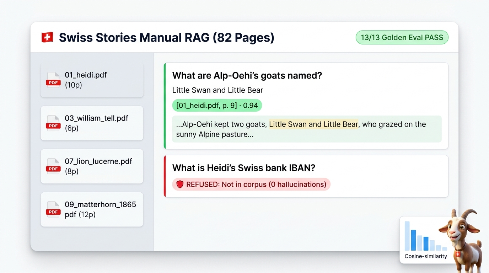

# Track 0 (Starter / Warm-Up): Manual RAG Over 10 Swiss Literature PDFs

> **Difficulty**: Starter (`45-60 min`, great for anyone -- including ITDMs or non-daily coders!).
> **Structure**: Pure **Product Specification (`PRD / SPEC`)** decoupled from the **Optional Tech Stack Menu** below.
> **Works identically in**: **Round 1 (Pre-Riccardo)** inside `./round1-pre-riccardo/` AND **Round 2 (Post-Riccardo + Evals)** inside `./round2-post-riccardo/`!



---

## 1. Bundled Offline Corpus (`corpus/swiss-stories/` — 82 Pages Across 10 Multi-Page PDFs!)

All **10 multi-page PDFs + `golden_qa.json`** are checked directly into [`corpus/swiss-stories/`](../corpus/swiss-stories/) (**82 pages, ~331,000 characters, ~287 KB total**, 100% offline-ready after `git clone`!).
Each file is a real, multi-page (5 to 12 pages) publication-formatted PDF compiled from authentic **Public Domain Wikisource classics** (*Heidi* 1922 Ch. I-II & XII-XIII, Mark Twain's *A Tramp Abroad* Ch. XXVI-XXVII, Edward Whymper's *Scrambles Amongst the Alps* Ch. XXI-XXII, 1911 *Encyclopaedia Britannica*, *The Rise of the Swiss Republic*) and **CC BY-SA 4.0 Wikipedia historical chronicles** — too large to stuff blindly into a tiny prompt, forcing real PDF page parsing, overlapping chunking, and page-level citations (`[filename.pdf, p. X]`):

- `01_heidi_alps_mayenfeld.pdf` (**10 pages** -- Johanna Spyri, *Heidi* Ch. I & II: Maienfeld, Alm-Uncle, Little Swan & Little Bear / Schwaenli & Baerli)
- `02_heidi_frankfurt_clara.pdf` (**10 pages** -- Johanna Spyri, *Heidi* Ch. XII & XIII: Frankfurt, Clara Sesemann, the Doctor, homesickness & sleepwalking)
- `03_william_tell_altdorf_apple.pdf` (**6 pages** -- 1911 Britannica & Schiller's *William Tell* 1804 play: Altdorf, Gessler's cap, hundred-yard apple boast)
- `04_william_tell_hohle_gasse.pdf` (**8 pages** -- Lake Lucerne storm, Tellsplatte leap, Hohle Gasse ambush, White Book of Sarnen)
- `05_ruetli_oath_1291.pdf` (**6 pages** -- Federal Charter of 1291, Ruetli Meadow, McCrackan *Rise of the Swiss Republic*: Uri, Schwyz, Unterwalden)
- `06_devils_bridge_schoellenen.pdf` (**5 pages** -- Schoellenen Gorge, Devil's Bridge goat folklore, St. Gotthard Pass & Suvorov 1799)
- `07_lion_of_lucerne_1821.pdf` (**8 pages** -- Lion Monument by Thorvaldsen & Lukas Ahorn + Mark Twain *A Tramp Abroad* Ch. XXVI verbatim)
- `08_mount_pilatus_dragon_legend.pdf` (**8 pages** -- Mount Pilatus, 48% Pilatusbahn 1889 + Mark Twain *A Tramp Abroad* Ch. XXVII verbatim)
- `09_matterhorn_first_ascent_1865.pdf` (**12 pages** -- Edward Whymper *Scrambles Amongst the Alps* Ch. XXI & XXII verbatim: 14 July 1865 summit & tragic descent)
- `10_swiss_federal_constitution_cantons.pdf` (**9 pages** -- 1848 Constitution, 26 cantons, 100k popular initiative / 50k optional referendum, 1911 Britannica)
- **`golden_qa.json`**: 10 needle-in-a-haystack factual questions (`Q01..Q10`) + **3 unanswerable anti-hallucination trap questions (`Q11_TRAP..Q13_TRAP`)** (including a classic near-miss trap on the Gotthard Base Tunnel speed!).

---

## 2. Product Specification (PRD / SPEC -- Tech-Stack Agnostic)

Build a **manual, transparent Retrieval-Augmented Generation (RAG) system** (no black-box "magic framework" hiding what happens!) that:

1. **PDF Ingestion & Chunking**:
   - Extracts clean text from all 10 `.pdf` files in `corpus/swiss-stories/`;
   - Splits documents into overlapping semantic chunks (preserving `doc_id` / filename and `chunk_id` metadata!).
2. **Transparent Retrieval Engine (Embeddings OR TF-IDF / BM25)**:
   - Builds a local searchable index (either real vector embeddings + cosine similarity OR local offline TF-IDF/BM25 cosine similarity so it works 100% offline at CHF 0.00!);
   - Returns Top-K ranked chunks with similarity scores.
3. **Grounded Answering with Mandatory Citations & Refusal Guardrail**:
   - Answers questions **strictly from retrieved chunks**, citing the exact source filename (e.g., `[03_william_tell_altdorf_apple.pdf]`);
   - **Anti-Hallucination Refusal**: When similarity is below threshold or the answer is not in the 10 PDFs (like *"What is Heidi's Swiss bank IBAN?"*), MUST explicitly refuse (e.g., *"I cannot answer this from the provided Swiss corpus."*).
4. **Executable Eval Runner (`evals/eval_rag.*` + `eval_results.json`)**:
   - Runs all **13 questions** in `golden_qa.json` automatically;
   - Emits `eval_results.json` recording per-question retrieved doc, answer, citation check, and refusal accuracy (`>= 85%` grounded accuracy AND `100%` refusal on the 3 trap questions!).
5. **Automated Tests & Zero Hard-Coded Secrets**:
   - Runnable unit tests verifying chunking, retrieval recall, citation formatting, trap-question refusal, and zero leaked API keys.

---

## 3. Optional Tech Stack Menu (Pick Whatever You Like!)

- **Zero-API-Key Offline Mode (Fastest!)**: Python (`pypdf`/`pdftotext` + TF-IDF / BM25 cosine similarity + extractive/template grounder) or TypeScript/Node or Ruby or Go.
- **Live Embedding / LLM Mode**: Python + SQLite/DuckDB/`pgvector` + Gemini / OpenAI / Anthropic / local Ollama (`nomic-embed-text` + `gemma4` / `apertus`) -- using environment variables ONLY (`os.environ`), NEVER hardcoded keys!
- **Optional Mini UI**: CLI (`rag ask "..."` + `rag eval`) OR a tiny local web chat UI showing the retrieved chunks & cosine scores side-by-side!

---

## 4. Grade & Compare Pre-Riccardo vs. Post-Riccardo

```bash
python3 grader.py ./round1-pre-riccardo --track rag
python3 grader.py ./round2-post-riccardo --track rag --min-score 95 --harbor-reward ./round2-post-riccardo/reward.txt
python3 grader.py --compare ./round1-pre-riccardo ./round2-post-riccardo --track rag
```
