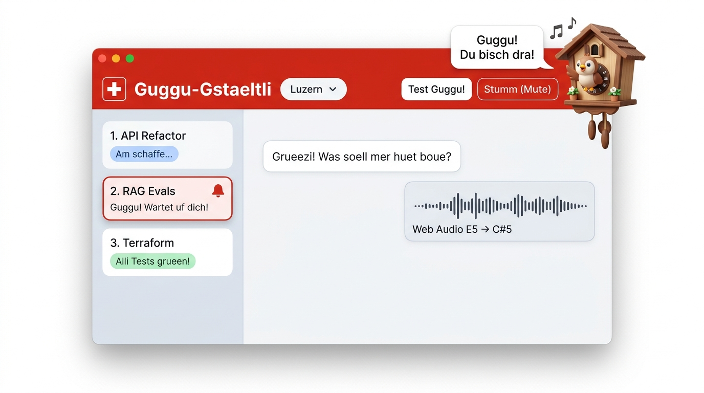

# Track 2 (Boss Mode -- Harness Builder): "Guggu-Gstaeltli" Swiss UI Harness

> **Swiss German Wordplay**: *"Gstaeltli"* (Swiss German for harness) + *"Guggu!"* (Swiss Cuckoo call) -- aka *"Gugger-Gschirr"* (*"Geschirr"* means both horse harness AND dishes, because an AI without guardrails breaks all the plates!).
> **Difficulty**: Boss Mode (`3-5h`, for bold builders!).
> **Structure**: Pure **Product Specification (`PRD / SPEC`)** decoupled from the **Optional Tech Stack Menu** below.
> **Works identically in**: **Round 1 (Pre-Riccardo)** inside `./round1-pre-riccardo/` AND **Round 2 (Post-Riccardo + Evals)** inside `./round2-post-riccardo/`!



---

## 1. Product Specification (PRD / SPEC -- Tech-Stack Agnostic)

Build a **Swiss-branded multi-conversation AI Coding UI Harness** satisfying these 6 requirements:

1. **Swiss Identity & Canton Selector**: Alpine Red (`#D52B1E`) + Crisp White (`#FFFFFF`) header with inline **Swiss Cross SVG** + canton selector (`Zuerich`, `Luzern`, `Zug`, `Bern`, `Graubuenden`).
2. **Authentic Swiss German (`Schwiizerduetsch`) UX**: UI chrome & greetings in Swiss German (*"Grueezi! Was soell mer huet boue?"*, *"Am schaffe..."*, *"Faertig! Guggu, du bisch dra!"*, *"Alli Tests sind grueen!"*) + Swiss-German system prompt wrapper for backend calls.
3. **Multi-Conversation Sidebar & Turn State Machine**: Manage `>= 2` parallel conversation threads (`idle` | `working` | `needs_human_turn`).
4. **Dual Execution Mode**:
   - **100% Offline Mock Swiss-German Agent Mode (REQUIRED)**: Simulates a 2-3s turn (`working -> needs_human_turn`) for zero-cost testing & classroom demos.
   - **Optional Real Backend Bridge**: Spawn `agy` (Antigravity CLI), `gemini`, `claude`, or `codex` CLI (or API via environment variables only -- NEVER hardcoded secrets!).
5. **Signature Feature: Synthesized `"Guggu!"` Cuckoo Chime + Animated Bird**:
   - Whenever **ANY** thread transitions `working -> needs_human_turn` (especially an inactive background tab!), synthesize a two-tone minor-third Cuckoo chime (**`E5 (659 Hz) -> C#5 (554 Hz)`** via Web Audio API `AudioContext` or native audio synth, zero external `.mp3` required!), animate a Cuckoo bird in the header, and optionally fire a desktop notification.
   - Provide a **"Test Guggu!"** button AND a **"Mute / Stumm"** toggle (for open-plan Swiss banks!).
6. **Automated Tests & Secret Hygiene**: Runnable tests asserting state transition -> cuckoo trigger, Swiss-German strings, and zero leaked secrets.

---

## 2. Optional Tech Stack Menu (Pick Whatever You Like!)

- **Desktop App**: **Electron** (fastest JS/TS desktop path), **Tauri** (Rust + WebView), **Flutter Desktop** (Dart), or **Python** (`PyWebView` / `PyQt` / `Tkinter`).
- **Zero-Install Localhost Web App (Corporate-Proxy Friendly)**: **Vanilla HTML5 + Web Audio API** (zero npm downloads!), **Vite + React / Svelte / Vue**, or **Ruby on Rails / Sinatra**.

---

## 3. Grade & Compare Pre-Riccardo vs. Post-Riccardo

```bash
python3 grader.py ./round1-pre-riccardo --track guggu
python3 grader.py ./round2-post-riccardo --track guggu --min-score 95 --harbor-reward ./round2-post-riccardo/reward.txt
python3 grader.py --compare ./round1-pre-riccardo ./round2-post-riccardo --track guggu
```
